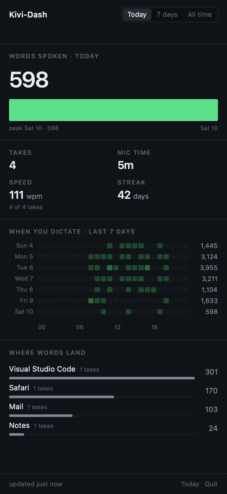

<p align="center">
  
</p>

<h1 align="center">Kivi-Dash</h1>

<p align="center">
  A macOS menu bar app that shows you your own <a href="https://www.sarvam.ai/">Kivi</a> dictation numbers.
  <br>
  <em>Unofficial, unaffiliated with Sarvam AI. A small side project.</em>
</p>

<p align="center">
  
  
</p>

---

Words spoken, takes, mic time, speed, streak, a seven-day trend, a day×hour
heatmap, and a per-app split — all read from the local Kivi database.

It is **numbers only**. Your transcript text is never stored by this app: not in
its database, not in a log, not in a cache. There is a test that fails the build
if any column capable of holding text ever appears in the schema.

## What is Kivi?

[Kivi](https://www.sarvam.ai/) is Sarvam AI's voice dictation tool for macOS: you
hold a hotkey, speak, and the words are pasted into whatever app has focus. It
keeps a local SQLite database of your dictation history on your Mac.

Kivi-Dash is a third-party utility that reads that database and turns it into a
set of usage analytics. It is not made by, endorsed by, or affiliated with
Sarvam AI — it just reads a file that happens to live on your machine.

## Why it exists

Kivi stores its dictation history in a plain SQLite file on your Mac, which
means the numbers are already there — but Kivi itself does not show them to you.
That leaves a gap, because Kivi's store is not a durable record:

- **Retention.** With zero-data-retention on, Kivi's store is a rolling few-day
  window while Kivi's own counters report hundreds of takes since install.
- **Incognito.** Kivi's eye toggle lets a take paste without being saved at all.

So Kivi-Dash keeps its own numbers-only database in
`~/Library/Application Support/com.shridhar600.kividash/` and appends each new take as
it appears. Your history keeps building after Kivi forgets it.

It also reports its coverage honestly. If Kivi says 558 takes succeeded and we
hold 120, it shows `holding 120 of 558 takes` — not a banner, just a quiet line,
because the gap has several indistinguishable causes and this app does not
pretend to know which.

## Features

- **Headline numbers** — words spoken, takes, mic time, speed (WPM), streak.
- **Ranges** — Today / 7 days / All time, with a seven-day sparkline.
- **When you dictate** — a day×hour heatmap over the last seven days.
- **Where words land** — a per-app split, ranked by words.
- **Honest coverage** — how much of Kivi's history this app actually holds.
- **Menu bar native** — no dock icon, no window; everything lives in the popover.

## Privacy

This is the point of the project, so it is spelled out rather than assumed:

- Kivi's database is opened **read-only**. Kivi-Dash never writes to it.
- Transcripts are counted in memory and dropped. They are never persisted.
- No network requests, no telemetry, no accounts.
- Its own database is `0600` inside a `0700` directory, and only contains
  counts, durations, timestamps and bundle identifiers.

Before reading, Kivi-Dash takes a throwaway snapshot using SQLite's online
backup API, because reading a live WAL database any other way silently loses
data. The snapshot is created `0600` before its first byte, and deleted
immediately after every ingest — including when the ingest fails.

Two failure modes matter if you read the source, because both are silent:

1. `immutable=1` on a live SQLite file **ignores the write-ahead log** and returns
   stale rows with no error. This app never does it to the source.
2. Copying only the main database file loses everything not yet checkpointed.
   Kivi's WAL is routinely larger than its database file.

One honest caveat: reading a live WAL database does write to Kivi's `-shm`
index file. It holds frame numbers and checksums, never transcript text, and
this is unavoidable for any consistent read.

## Requirements

- macOS 14 or later
- Kivi installed at `/Applications/Kivi.app`
- Swift 6 toolchain (Xcode 16+, or just the Command Line Tools)

## Install

There are no prebuilt releases yet — build from source:

```bash
git clone https://github.com/Shridhar600/Kivi-Dash.git && cd Kivi-Dash
./build.sh                # test, build, assemble and sign the app bundle
./build.sh --skip-tests   # skip the test suite
./build.sh --install      # also copy the bundle to /Applications
```

The bundle lands in `build/Kivi-Dash.app`. It is **ad-hoc signed**, which is
enough to run locally, but means Gatekeeper quarantines a copy downloaded from
the internet — right-click it and choose Open.

The app is deliberately **not sandboxed**. The App Sandbox cannot read another
app's Application Support directory and no entitlement permits it, so a
sandboxed build simply cannot do this job. It is distributed directly, not
through the Mac App Store.

There is no launch-at-login registration yet — the app only ingests while it is
running. Quit it and collection stops until you reopen it.

## How the numbers are defined

- **Words** — ICU word segmentation, not whitespace splitting, so hyphenated
  compounds and Indic text are handled sanely. The method is recorded per row.
  Because text is never stored, a future change to this algorithm can only ever
  apply to *new* takes: an already-purged take can never be recounted.
- **Speed** — words per minute of mic-open time, as a ratio of totals rather than
  an average of per-take rates, over takes between 5 and 300 seconds. Kivi's
  duration includes pauses and idle time, so one left-open take can be a large
  share of your total. The sample size is always shown (`142 of 157 takes`)
  because a rate computed from 90% of your takes is a different claim from one
  computed from all of them.
- **Clipboard** — Kivi's clipboard-history captures are ingested and counted, but
  they are **not** counted as speech. The headline figures and the per-app split
  are both dictation-only, so they agree with each other.
- **Streak** — consecutive local days with at least one dictation, counting back
  from today or yesterday.

## Limitations

Worth knowing before you rely on it:

- **Not a real segmenter for Tamil.** ICU treats a run of space-less Tamil as a
  single word, so Tamil word counts are badly low. Hinglish, the common case, is
  fine. Fixing this needs a language-specific dictionary segmenter, not a tweak.
- **Zero-retention gaps are permanent.** Takes Kivi never wrote — incognito, or
  purged before this app was running — cannot be recovered.
- **No accuracy or edit metrics.** Kivi does not record what you changed
  afterwards, so "words spoken" is not "words kept".
- **Ingest requires the app to be running.** There is no launch-at-login yet.
- **Assumes Kivi at `/Applications/Kivi.app`** and a stable `ZCAPTURE` schema. If
  Kivi changes its schema the app refuses to write and the menu bar icon turns
  red, rather than recording zeros.
- **The heatmap and app list are capped** at 7 days and 5 apps so the window
  cannot resize when you switch ranges. That leaves whitespace on sparse days.

## Tests

```bash
swift test
swift format lint -r Sources Tests --strict
```

The suite concentrates on the places where being wrong would be invisible:
snapshot safety, ingest idempotence, the guarantee that a purged take is never
subtracted from your totals, timezone re-bucketing, per-install isolation, and
the definition of words-per-minute.

## Contributing

Bug reports and pull requests are welcome. See [CONTRIBUTING.md](CONTRIBUTING.md)
for the build commands and the architecture ground rules.

## Disclaimer

Kivi-Dash is an independent, unofficial project. It is **not affiliated with,
endorsed by, or supported by Sarvam AI**, and "Kivi" is used purely to describe
what the app reads. All trademarks belong to their respective owners.

## Licence

[MIT](LICENSE). Not affiliated with or endorsed by Sarvam AI.
